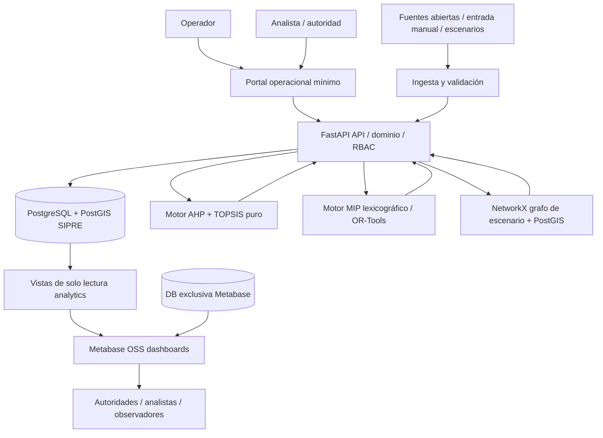
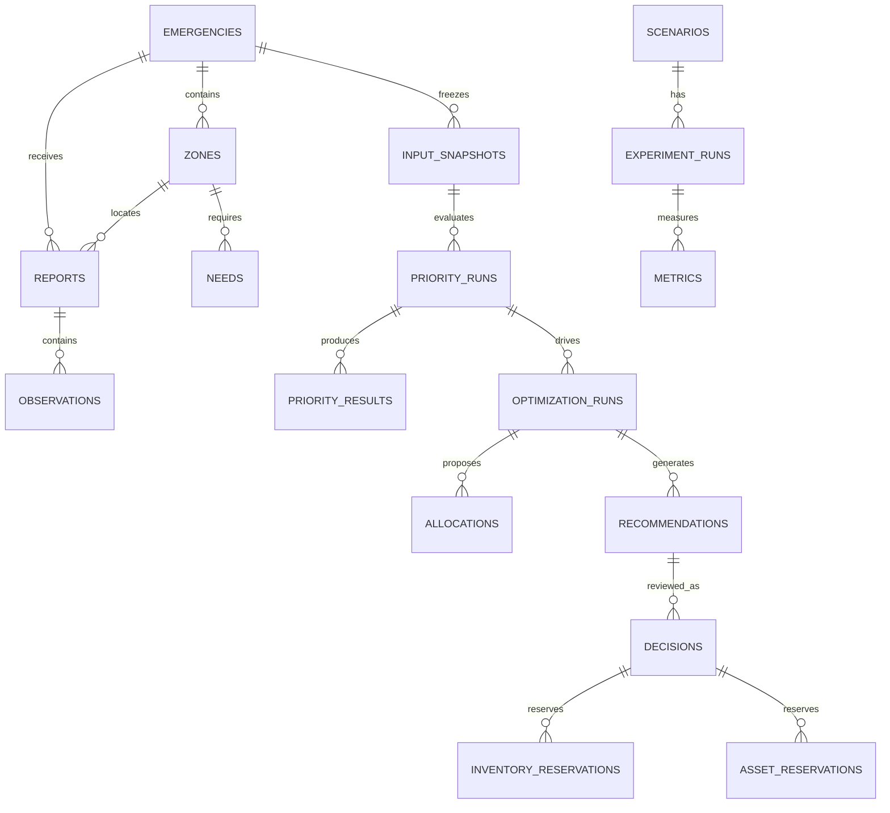

# SIPRE — Fase 6: Arquitectura de software, datos, APIs e integración Metabase

**Documento:** `SIPRE_ARQUITECTURA_v1.md`  
**Versión de diseño:** 1.0 — 2026-10-16  
**Estado:** Arquitectura propuesta para MVP académico, **pendiente de implementación y pruebas**. No certifica operación en una emergencia real.  
**Responsables:** ChatGPT (arquitectura), Codex (implementación posterior), equipo humano (aprobación).  
**Insumos formales:** `SIPRE_PRIORIZACION_v1.md` (F4), `SIPRE_OPTIMIZACION_v1.md` (F5), requisitos RF/RNF presentados en Fase 3 y formulación Fase 2. La investigación Gemini en PDF fue utilizada en el proyecto previo, pero en esta elaboración no ha sido posible volver a inspeccionar íntegramente su archivo; las reglas nuevas se identifican como decisiones de arquitectura, no como contenidos validados de ese PDF.

> **Contrato rector:** SIPRE **recomienda**; una persona autorizada **decide**. La confirmación del prototipo no equivale a despacho operacional real. Metabase **lee y visualiza**, no aprueba, escribe ni opera.

## 0. Alcance y congelamiento de decisiones

SIPRE es un sistema de apoyo a decisiones espaciales para escenarios de post-emergencia, diseñado inicialmente para simulación y validación académica. Interpreta observaciones, calcula prioridades territoriales con AHP y TOPSIS anclado, y recomienda distribuciones físicamente viables mediante optimización lexicográfica: (1) maximizar cobertura humanitaria H y (2) minimizar costo logístico condicionado a preservar H. El MVP asigna **un destino por salida/vehículo**, rutas explícitamente verificadas **dentro del escenario**; no afirma resolver CVRP multiparada completo.

**No incluidos:** integración de datos operativos SENAPRED/FIBE/ALFA en vivo; alerta temprana; triaje médico individual; despacho automático; GPS de flota en vivo; rutas transitables garantizadas en terreno; auditoría/certificación institucional real; modo sin energía ni servidor local; apps nativas o un segundo dashboard analítico.

**Stack aprobado para planificación:** Python + FastAPI + Pydantic + SQLAlchemy/Alembic, PostgreSQL + PostGIS, OR-Tools, Metabase OSS, Docker Compose, pytest, NetworkX para grafo vial sintético del MVP; UI operacional mínima servida por FastAPI/Jinja2+HTMX **como decisión de arquitectura propuesta**, sujeta a confirmación del equipo. No desarrollar un dashboard React paralelo.

## 1. Decisiones de arquitectura (ADR)

| ADR | Decisión | Justificación / límite |
|---|---|---|
| ADR-001 | **Monolito modular backend**, no microservicios iniciales | Despliegue y observabilidad sencillos en MVP; separar por módulos para extraer componentes posteriormente. |
| ADR-002 | **PostgreSQL/PostGIS como fuente operacional y analítica**, con esquemas SQL separados | Consistencia relacional, trazabilidad y análisis espacial. |
| ADR-003 | **Metabase OSS sólo lectura** conectado a vistas `analytics` | BI/indicadores sin duplicar aplicación; consultas SQL y dashboards no deben ejecutar decisiones operativas. |
| ADR-004 | **Metabase app DB diferente** de SIPRE DB | Persistencia de usuarios, preguntas y dashboards de Metabase separada de datos del proyecto. |
| ADR-005 | **Operaciones mediante FastAPI + UI ligera** | Importar reportes, configurar corridas, revisar/rechazar/aprobar; Metabase no es sistema transaccional. |
| ADR-006 | **Motor `prioritization` puro y desacoplado** | Implementar literalmente AHP, ocho criterios y TOPSIS anclado definidos por F4. |
| ADR-007 | **Motor `optimization` puro y desacoplado** | Implementar literalmente restricciones, lexicografía y FIFO-FEASIBLE definidos por F5. |
| ADR-008 | **Snapshot inmutable por corrida** | Evita mezclar stock/rutas/reportes cambiantes durante cálculo; asegura trazabilidad y reproducibilidad. |
| ADR-009 | **Confirmación transaccional con control de concurrencia** | No aprobar propuestas obsoletas ni reservar dos veces el mismo recurso. |
| ADR-010 | **Red vial sintética versionada + NetworkX MVP** | PostGIS almacena geometrías pero no calcula por sí solo todos los caminos del grafo; NetworkX calcula rutas sobre arcos habilitados. No equivale a validación vial en terreno. |
| ADR-011 | **Versiones y perfiles de modelo inmutables tras aprobación** | Comparabilidad de resultados y auditoría matemática. |
| ADR-012 | **Tests con datos simulados y despliegue local** | Uso académico; no prometer disponibilidad institucional certificada. |

## 2. Vista lógica y contexto C4 nivel 1–2



**Límite de confianza:** el acceso a datos de dominio es mediante API; el rol de Metabase en BD sólo puede hacer `SELECT` sobre vistas públicas para el prototipo. La UI transaccional no llama al motor desde el navegador; lo hace el backend autorizado.

### Componentes backend

| Módulo | Responsabilidad | Prohibición explícita |
|---|---|---|
| `auth` | Identidades, roles, sesiones, autorización | No permitir permisos amplios implícitos. |
| `emergencies` | Crear/cerrar emergencia, identificar revisiones | No editar datos de emergencia cerrada sin reapertura auditada. |
| `zones` | Zonas, geometrías, población basal | No crear geometrías ficticias como datos reales. |
| `observations` | Reportes crudos, fuentes, unidades, calidad, verificación | No convertir NULL a cero. |
| `resources` | Catálogo, bodegas, stock, reservas y unidades | No contar sugerencias como stock reservado. |
| `transport` | Flota, cualificaciones, rutas, red, bloqueos | No presumir transitabilidad por distancia euclidiana. |
| `profiles` | Definiciones/versiones de criterios, matrices AHP, reglas logísticas | No modificar perfiles usados por corridas antiguas. |
| `prioritization` | Pipeline F4, explicación, incertidumbre, rangos | No asignar recursos ni mandar despachos. |
| `optimization` | Pipeline F5, OR-Tools, baseline y resultados de factibilidad | No confirmar automáticamente planes. |
| `recommendations` | Revisar/ajustar/rechazar/reoptimizar | No aprobar sin verificar versiones actuales. |
| `audit` | Bitácora de cambios y decisiones | No permitir borrado desde UI o API común. |
| `experiments` | Fixtures, seeds, ejecuciones FIFO y SIPRE, KPI | No mezclar datos demo con datos no simulados. |
| `analytics` | Vistas SQL de lectura | No modificar decisiones desde Metabase. |

## 3. Flujo operacional end-to-end

1. Usuario autorizado registra una emergencia `DRAFT` o importa escenario inequívocamente marcado `SIMULATED`.
2. Registra/importa zonas, geometrías, fuentes, observaciones con `observed_at` y calidad, demandas explícitas y cantidades en unidades declaradas, depósitos, flota, red vial y bloqueos.
3. Un validador controla referencialidad, unidad física, consistencia espacial y estado de datos (`observed`, `estimated_approved`, `unknown`). La demanda no aprobada/desconocida no se transforma en valor de despacho.
4. Se fija `input_snapshot` inmutable con `input_revision`, perfiles AHP/criterios, versión de red y fecha de corte `as_of_time`.
5. Se ejecuta priorización F4 y se guardan resultado, ranking, factorización, intervalos y flags por zona. Corrida `SUCCESS` sólo si hay salida reproducible.
6. Desde la **misma** corrida/snapshot, se prepara entrada del optimizador F5. Los recursos disponibles resultan de stock libre descontadas las reservas/compromisos confirmados.
7. Un validador de transporte obtiene rutas a un destino en grafo de escenario y elimina rutas bloqueadas, desconocidas o incompatibles. Las rutas se versionan junto con sus arcos.
8. El solver ejecuta objetivo humanitario y luego objetivo logístico respetando `H >= H* - epsilon_H`. Registra estatus independientes, objetivo H, costo, asignaciones, déficits y explicaciones.
9. Se guarda una **recomendación** `GENERATED`; el usuario autorizado puede revisar, modificar solicitudes/restricciones y pedir otra corrida. La recomendación anterior permanece histórica.
10. Para aceptar, una transacción vuelve a verificar `input_revision`, `inventory_revision`, `road_revision`, validez de ruta, restricciones, reserva global de activos y autorización del actor. Si algo cambió: `STALE_REQUIRES_REOPTIMIZATION` sin reservar ni aprobar. Si todo coincide, crea **decisión humana separada** y reservas de recursos; no dispara despacho externo.
11. Metabase muestra datos desde vistas `analytics` en las que se distinguen `SIMULATED`, recomendaciones y decisiones aprobadas; tiempos de actualización no son garantía de tiempo real.

## 4. Modelo de dominio y separación de bases

Base operacional recomendada: `sipre`, con esquemas `core`, `ops`, `geo`, `model`, `planning`, `audit`, `experiments`, `analytics`. El nombre de cada tabla es propuesta para Codex y deberá implementarse mediante migraciones versionadas. Base administrativa de Metabase: `metabase_app` con credenciales **diferentes**.

Reglas universales: claves UUID para entidades principales; `timestamptz` en UTC; unidad, procedencia, calidad y precisión para medidas; `created_at`, `updated_at`, `created_by`, `row_version` donde aplique; soft delete sólo cuando proceda; **snapshots y resultados nunca se editan**. Los SQL `CHECK`, `FK`, `UNIQUE` y transacciones respaldan las reglas de negocio; un simple validador Python no basta.

### 4.1 Catálogo de entidades y cardinalidades

| Esquema.tabla | Claves/campos imprescindibles | Relaciones / restricciones |
|---|---|---|
| `core.users` | `user_id PK`, `login UNIQUE`, `password_hash`, `active` | Roles mediante `user_roles`; no contraseña plana. |
| `core.roles`, `core.user_roles` | `role_code PK`; usuario+rol único | `ADMIN`, `OPERATOR`, `ANALYST`, `DECISION_MAKER`, `VIEWER`. |
| `ops.emergencies` | `emergency_id PK`, `name`, `hazard_type`, `start_at`, `mode`, `state`, `input_revision` | `mode=SIMULATED` en prototipo; estado auditado. |
| `geo.zones` | `zone_id PK`, `emergency_id FK`, `name`, `geom MULTIPOLYGON SRID 4326`, `centroid_geom`, `baseline_population` | Zonas versionadas; no asumir población afectada por total basal. Índice GiST. |
| `ops.sources` | `source_id PK`, `organization`, `kind`, `trust_profile_id` | Confianza catalogada no equivale automáticamente a veracidad. |
| `ops.reports` | `report_id PK`, `emergency_id FK`, `zone_id FK`, `source_id FK`, `observed_at`, `recorded_at`, `status`, `raw_payload JSONB` | Reporte original inmutable; corrección es nueva versión. |
| `ops.observations` | `observation_id PK`, `report_id FK`, `metric_code`, `value_numeric NULL`, `unit`, `evidence_status`, `quality_flags JSONB` | `UNKNOWN` mantiene NULL; `OBSERVED`/`ESTIMATED_APPROVED` con procedencia. |
| `ops.needs` | `need_id PK`, `zone_id FK`, `resource_type_id FK NULL`, `specialty_type_id FK NULL`, `quantity NULL`, `unit`, `status`, `reported_at` | Exactamente un tipo; no aprobar demanda desconocida automáticamente. |
| `ops.resource_types` | `resource_type_id PK`, `unit`, `discrete`, `kg_per_unit`, `m3_per_unit` | `kg/m³` definidos y no negativos; conversiones declaradas. |
| `ops.depots` | `depot_id PK`, `name`, `geom POINT SRID 4326`, `active` | Origen de vehículos y bienes. |
| `ops.inventory_balances` | `depot_id FK`, `resource_type_id FK`, `quantity`, `revision`, `updated_at` | Unicidad depósito/tipo; saldo no negativo. |
| `ops.inventory_ledger` | `entry_id PK`, `depot_id`, `resource_type_id`, `change_quantity`, `reason`, `decision_id NULL`, `created_at` | Journal append-only; permite conciliar stock. |
| `ops.inventory_reservations` | `reservation_id PK`, `decision_id FK`, `depot_id`, `resource_type_id`, `quantity`, `state` | Reservas efectivas sólo tras decisión. |
| `ops.physical_assets` | `asset_id PK`, `asset_tag UNIQUE`, `type`, `state`, `base_id` | Clave global para evitar doble uso entre emergencias. |
| `ops.vehicles` | `asset_id PK/FK`, `max_kg`, `max_m3`, `base_depot_id` | Capacidad física y disponibilidad declaradas. |
| `ops.specialized_units` | `asset_id PK/FK`, `specialty_type_id`, `qualification_status`, `base_depot_id` | Unidad indivisible y cualificada; no duplicada como vehículo en un mismo plan. |
| `ops.asset_reservations` | `reservation_id PK`, `asset_id`, `decision_id`, `window_start`, `window_end`, `state` | Impedir intervalos simultáneos del mismo activo (validación transaccional y exclusión o bloqueos). |
| `geo.road_nodes` | `node_id PK`, `geom POINT 4326` | Grafo versionado de escenario. |
| `geo.road_edges` | `edge_id PK`, `from_node`, `to_node`, `geom LINESTRING`, `length_m`, `travel_sec`, `status`, `network_revision` | Bloqueos y direccionalidad; GiST; `UNKNOWN` no transitable por defecto. |
| `geo.route_candidates` | `route_id PK`, `vehicle_type`, `depot_id`, `zone_id`, `path_geom`, `length_km`, `time_hr`, `route_status`, `network_revision`, `expires_at` | Rutas de un destino; condición `VERIFIED_OPEN/RESTRICTED` **en escenario**. |
| `geo.route_candidate_edges` | `route_id FK`, `edge_id FK`, `sequence_no` | Ruta reproducible; índice por edge para invalidación por bloqueo. |
| `model.criteria_profiles` | `criteria_profile_id PK`, `version`, `config JSONB`, `approved`, `hash` | Inmutable tras uso. C1–C8, normalizaciones y rangos. |
| `model.ahp_profiles` | `ahp_profile_id PK`, `version`, `pairwise_matrix JSONB`, `weights JSONB`, `ci`, `cr`, `approved` | Sólo aprobado con consistencia; no inventar validación experta. |
| `model.classification_profiles` | `classification_profile_id PK`, `config JSONB`, `version` | Bandas demo separadas de umbrales operativos reales. |
| `model.input_snapshots` | `snapshot_id PK`, `emergency_id`, `cutoff_at`, `inventory_revision`, `network_revision`, `input_revision`, `fingerprint`, `payload_ref` | Snapshot inmutable; datos del cálculo; fingerprint reproducible. |
| `model.priority_runs` | `priority_run_id PK`, `snapshot_id FK`, `criteria_profile_id`, `ahp_profile_id`, `algorithm_version`, `state`, `started_at`, `ended_at` | Una corrida en un snapshot. |
| `model.priority_results` | `priority_run_id FK`, `zone_id FK`, `score`, `rank`, `level`, `uncertainty`, `lower`, `upper`, `needs_verification` | UNIQUE `(priority_run_id,zone_id)`; 0≤score≤1. |
| `model.priority_factors` | `priority_run_id`, `zone_id`, `criterion_code`, `raw_value NULL`, `normalized_value`, `weight`, `data_status`, `source_summary`, `delta_counterfactual` | Ocho factores por resultado; `delta_counterfactual` no es contribución lineal de TOPSIS. |
| `planning.optimization_profiles` | `profile_id PK`, `version`, `humanitarian_weights JSONB`, `epsilon_h`, `horizon_hr`, `return_to_base`, `solver_params` | Igualdad con F5; costos con unidades explícitas. |
| `planning.optimization_runs` | `optimization_run_id PK`, `priority_run_id FK`, `snapshot_id FK`, `profile_id`, `solver_version`, `stage1_status`, `stage2_status`, `h_star`, `h_final`, `logistic_cost`, `gap`, `duration_ms` | Snapshot idéntico al de prioridad, o revisión validada; resultados inmutables. |
| `planning.allocations` | `allocation_id PK`, `optimization_run_id FK`, `zone_id`, `depot_id`, `resource_type_id NULL`, `unit_asset_id NULL`, `vehicle_asset_id NULL`, `quantity`, `route_id` | Bien/unidad claramente tipificado; no sobreasignación. |
| `planning.unmet_needs` | `optimization_run_id FK`, `need_id FK`, `quantity_unmet`, `data_status` | Incluir necesidades desconocidas como `UNKNOWN`, sin inventar déficit. |
| `planning.recommendations` | `recommendation_id PK`, `optimization_run_id FK`, `state`, `created_at`, `expires_at`, `snapshot_id` | `GENERATED/UNDER_REVIEW/ACCEPTED/MODIFIED/REJECTED/STALE`; no orden operativa. |
| `planning.decisions` | `decision_id PK`, `recommendation_id FK`, `decided_by FK`, `action`, `rationale NULL`, `decided_at`, `approved_payload` | Decisión humana separada; puede referir plan modificado debidamente revalidado. |
| `audit.events` | `audit_id PK`, `actor_id`, `action`, `object_type`, `object_id`, `event_at`, `before_hash`, `after_hash`, `metadata JSONB` | Append-only; no registrar secretos ni datos médicos personales. |
| `experiments.scenarios` | `scenario_id PK`, `name`, `seed`, `fixture_version`, `mode` | Etiquetar siempre `SIMULATED`. |
| `experiments.runs` | `experiment_run_id PK`, `scenario_id FK`, `method`, `snapshot_id`, `optimization_run_id NULL`, `software_version`, `seed` | `method=SIPRE|FIFO_FEASIBLE`; entrada equivalente. |
| `experiments.metrics` | `experiment_run_id FK`, `metric_code`, `value`, `unit`, `definition_version` | KPI sin confundir H con % físico o vidas salvadas. |

### 4.2 Diagrama ER conceptual (subset de relaciones)



**Decisiones de datos que NO debe improvisar Codex:**
- La revisión/inventario es **global respecto al activo**; una misma ambulancia no se puede confirmar en dos emergencias simultáneamente.
- `priority_run` no mezcla emergencias ni snapshots. AHP se guarda con sus pesos CR y versión.
- El reportado `UNKNOWN` no se transforma en un dato observado 0; demanda estimada sólo si fue aprobada para planificación.
- `physical_asset_id` único previene doble conteo si una ambulancia figura tanto como vehículo como unidad especializada; el modelo de optimización debe aplicar restricciones cruzadas.
- Las reservas/decisiones deben vincularse a un *horizonte* y caducidad de plan. El saldo libre tiene que basarse en inventario confirmado y reservas vigentes, no en sumas de sugerencias.
- El bloqueo de un arco invalida las `route_candidates` que lo atraviesan, obliga a marcar recomendaciones afectadas como `STALE` y requiere reoptimizar antes de aceptar.

## 5. Datos geoespaciales, rutas y validación

- Geometrías fuente se almacenan en WGS84 `EPSG:4326`; distancias **no** se calculan con `ST_Distance(geom4326,geom4326)` interpretando grados como metros. Para distancias métricas usar `geography` apropiadamente o proyección local validada; el grafo guarda longitudes en metros y tiempos en segundos.
- `zone.centroid_geom`: punto representativo verificado y contenido en zona cuando sea factible; para polígonos cóncavos preferir `ST_PointOnSurface`, no suponer que `ST_Centroid` siempre cae dentro.
- Red vial de escenario `road_edges` dirigida cuando corresponde; mantiene costos por arco, restricciones y versión. NetworkX calcula caminos en Python y persistimos una secuencia de arcos junto con costo y `network_revision`.
- `UNKNOWN`, `BLOCKED` y rutas que exceden horizonte quedan fuera del conjunto factible de confirmación. `VERIFIED_OPEN`/`VERIFIED_RESTRICTED` sólo tienen significado **dentro del dataset/escenario con su procedencia**.
- Los mapas en Metabase del MVP usarán **lat/lon de punto por zona/recurso** y herramientas de pin; no prometer polígonos coloreados dinámicamente como si fueran nativos de PostGIS. Un mapa regional personalizado puede evaluarse aparte (GeoJSON, disponibilidad web y límites de Metabase), pero no es condición crítica del MVP.

## 6. Contrato de servicios y APIs REST

Prefijo `/api/v1`; JSON `application/json`; timestamps ISO 8601 offset-aware; UUID como texto; cantidades decimales con unidades; errores estructurados; paginación (`limit`, `cursor`); `request_id`/`correlation_id` para traza; Idempotency-Key en POST que puede crear planes o decisiones.

| Endpoint propuesto | Método | Rol | Propósito / datos |
|---|---|---|---|
| `/auth/login`, `/auth/logout`, `/auth/me` | POST/POST/GET | autenticado | Sesiones; configuración real de autenticación se valida en ADR. |
| `/emergencies` | POST/GET | OPERATOR+/VIEWER+ | Crear/listar escenarios/emergencias. |
| `/emergencies/{id}` | GET/PATCH | VIEWER+/OPERATOR+ | Consultar/actualizar con versión esperada. |
| `/emergencies/{id}/zones` | POST/GET | OPERATOR+/VIEWER+ | Cargar/consultar zonas y geometría. |
| `/emergencies/{id}/reports` | POST/GET | OPERATOR+/VIEWER+ | Reportes con fuente y timestamps. |
| `/emergencies/{id}/needs` | POST/GET | OPERATOR+/VIEWER+ | Necesidades con estados `KNOWN/UNKNOWN`. |
| `/depots`, `/resources/types`, `/inventory` | GET/POST/PATCH según objeto | según rol | Inventarios, unidades, revisiones globales. |
| `/vehicles`, `/specialized-units` | GET/POST/PATCH | según rol | Activos, estado y capacidades. |
| `/emergencies/{id}/roads` | GET/PATCH | VIEWER+/OPERATOR+ | Reportar cambios viales, invalidar rutas. |
| `/profiles/criteria`, `/profiles/ahp`, `/profiles/optimization` | GET/POST | ANALYST+, ADMIN aprobación | Versionar matrices, criterios, perfiles sin mutaciones in-place. |
| `/emergencies/{id}/snapshots` | POST/GET | ANALYST+/VIEWER+ | Congelar entrada atómica, hash y revisiones. |
| `/emergencies/{id}/priority-runs` | POST/GET | ANALYST+/VIEWER+ | Calcular/listar ranking F4. |
| `/priority-runs/{run_id}/results` | GET | VIEWER+ | Factores, intervalos, explicación. |
| `/emergencies/{id}/optimization-runs` | POST/GET | ANALYST+/VIEWER+ | Calcular/listar asignaciones F5. |
| `/optimization-runs/{run_id}/results` | GET | VIEWER+ | H, costo, rutas, déficit, solver status. |
| `/recommendations/{id}` | GET | VIEWER+ | Recomendación no aprobada/estado. |
| `/recommendations/{id}/review` | POST | DECISION_MAKER | Marcar en revisión, notas. |
| `/recommendations/{id}/accept` | POST | DECISION_MAKER | Revalidar todo y guardar decisión + reservas atómicamente. |
| `/recommendations/{id}/reject` | POST | DECISION_MAKER | Registrar rechazo justificado. |
| `/recommendations/{id}/request-reoptimization` | POST | DECISION_MAKER | No editar directamente la solución; crea nueva solicitud/configuración/revisión. |
| `/decisions/{id}` | GET | VIEWER+ | Aprobación humana y auditoría. |
| `/experiments/scenarios`, `/experiments/runs` | GET/POST | ANALYST+ | Cargar y comparar escenarios controlados. |
| `/health/live`, `/health/ready` | GET | monitor | Estado del proceso y dependencias, no exponer secretos. |

**Nota de permisos:** VIEWER+, OPERATOR+ representan lectura por capacidades, **no una jerarquía rígida**. Implementar autorización por acción y no permitir que un ANALYST apruebe automáticamente decisiones. Para salud del sistema, separar endpoints públicos mínimos de diagnóstico administrativo autenticado.

### 6.1 Ejemplo de cálculo de prioridad

Solicitud `POST /api/v1/emergencies/{id}/priority-runs`:

```json
{"snapshot_id":"uuid","criteria_profile_id":"uuid","ahp_profile_id":"uuid","classification_profile_id":"uuid","idempotency_key":"run-001"}
```

Respuesta aceptada `202`:

```json
{"priority_run_id":"uuid","state":"QUEUED","snapshot_id":"uuid","created_at":"2026-10-16T21:00:00Z","status_url":"/api/v1/priority-runs/uuid"}
```

### 6.2 Ejemplo de optimización

Solicitud `POST /api/v1/emergencies/{id}/optimization-runs`:

```json
{"snapshot_id":"uuid","priority_run_id":"uuid","optimization_profile_id":"uuid","algorithm_version":"optimization-v1","method":"SIPRE"}
```

Respuesta `202` con `optimization_run_id` y estado `QUEUED`; lectura posterior expone `stage1_status`, `stage2_status`, `h_star`, `h_final`, `epsilon_h`, `logistic_distance_km`, `allocations`, `unmet_needs`, `route_flags`, `warnings` y `model_versions`. No fingir que el solver terminó sólo porque se aceptó el trabajo.

### 6.3 Confirmación humana — concurrencia

Solicitud `POST /api/v1/recommendations/{id}/accept`:

```json
{
  "expected_recommendation_version": 3,
  "expected_inventory_revision": 12,
  "expected_network_revision": 8,
  "expected_input_revision": 19,
  "rationale": "Plan revisado en simulación"
}
```

La `actor_id` se obtiene de la identidad autenticada, **no** del payload. Respuesta `201` si se creó una decisión y reservas; `409 Conflict` + `STALE_REQUIRES_REOPTIMIZATION` si cambió cualquier versión relevante; `422` si hay restricciones físicas inválidas; `403` si rol no autorizado. Nunca completar reservas parcialmente cuando la transacción de aprobación falla.

### 6.4 Errores de dominio

```json
{"error":{"code":"STALE_REQUIRES_REOPTIMIZATION","message":"Las rutas o el inventario cambiaron","correlation_id":"...","details":{"network_revision_current":9}}}
```

Códigos relevantes: `INVALID_OBSERVATION`, `UNKNOWN_IS_NOT_ZERO`, `INVALID_AHP_PROFILE`, `PRIORITY_SNAPSHOT_MISMATCH`, `ROUTE_NOT_VERIFIED`, `CAPACITY_EXCEEDED`, `RESOURCE_NOT_AVAILABLE`, `MODEL_INVALID`, `SOLVER_TIMEOUT`, `STALE_REQUIRES_REOPTIMIZATION`, `FORBIDDEN`.

## 7. Consistencia, snapshots y concurrencia

**Congelamiento:** al iniciar una corrida, la API crea un snapshot lógico/inmutable con las versiones de emergencia, reportes, perfiles, inventario, red, horas y restricciones, además de un hash de carga normalizada. Toda consulta del cálculo usa el snapshot, no tablas vivas de forma fragmentada.

**Bloqueo en aprobación:** transacción SQL con bloqueo de filas afectadas (`FOR UPDATE`) y `row_version` esperado en inventario, reservas y activos. Revalidar: i) usuario, ii) recomendación pendiente, iii) revisión de red, iv) stock libre, v) disponibilidad y tiempo de uso del activo, vi) ruta factible, vii) demanda/prohibiciones vigentes. Si cualquier comprobación falla, rollback total y resultado `409` o `422` según causa. Para intervalos de activos, considerar restricciones exclusivas PostgreSQL o validación serializable demostrada con tests de carreras.

**Doble aprobación:** POST idempotente y `UNIQUE` sobre aprobación activa de recomendación; la segunda petición no duplica reservas.

**Historial:** toda reoptimización crea nuevo `optimization_run` y `recommendation`. No se sobreescribe la anterior y no se eliminan déficits antiguos.

## 8. Metabase OSS: modelo y límites

Metabase no es interfaz transaccional: utilizará rol `sipre_metabase_reader` con `CONNECT`, `USAGE` en esquema `analytics`, `SELECT` sólo sobre vistas permitidas y **sin acceso** directo a `core`, `ops`, `model`, `planning`, `audit`, `experiments` ni privilegios de escritura. No habilitar acciones de edición o cargas con ese usuario. Filtrar/anonimizar información agregada en vistas SQL. Metabase almacena sus colecciones/cuentas/dashboards en `metabase_app`, distinta de `sipre`.

**Vistas de lectura obligatorias:**

| Vista | Granularidad | Campos esenciales / finalidad |
|---|---|---|
| `analytics.v_emergency_overview` | emergencia | `emergency_id`, `mode`, `state`, `last_data_at`, `zones_count`, `active_critical_zones`, `data_staleness_hours` |
| `analytics.v_zone_priority_latest` | emergencia + zona + corrida vigente | `zone_id`, `zone_name`, `latitude`, `longitude`, `priority_score`, `rank`, `level`, `score_lower`, `score_upper`, `uncertainty_index`, `needs_verification`, `as_of_time` |
| `analytics.v_zone_priority_history` | corrida + zona | `priority_run_id`, `evaluated_at`, `zone_id`, `score`, `rank`, `uncertainty_index` |
| `analytics.v_priority_factors` | corrida + zona + criterio | `criterion_code`, `raw_value`, `normalized_value`, `weight`, `status`, `factor_explanation`, `delta_counterfactual` |
| `analytics.v_resource_inventory` | bodega + recurso | `depot`, `resource`, `unit`, `stock_total`, `reserved`, `available`, `revision` |
| `analytics.v_transport_availability` | activo | `vehicle_or_unit`, `kind`, `availability`, `capacity_kg`, `capacity_m3`, `base` |
| `analytics.v_recommended_allocations` | corrida + asignación | `recommendation_id`, `zone_id`, `resource_or_specialty`, `quantity`, `unit`, `vehicle`, `route_length_km`, `state` |
| `analytics.v_unmet_needs` | corrida + necesidad | `need_id`, `zone_id`, `resource_type`, `demand_known`, `delivered`, `unmet`, `unknown_flag` |
| `analytics.v_human_decisions` | decisión + recomendación | `decision_at`, `recommendation_id`, `action`, `approved_plan`, `modified_flag` (sin detalles sensibles del actor) |
| `analytics.v_route_conditions` | red + arco/ruta | `route_id`, `zone_id`, `status`, `distance_km`, `network_revision`, `last_verified_at`, `simulated` |
| `analytics.v_experiment_comparison` | escenario + método | `scenario_id`, `method`, `seed`, `metric_code`, `value`, `unit`, `algorithm_version`, `run_at` |
| `analytics.v_operational_kpis` | emergencia + corrida | `coverage_known_pct`, `unmet_known_total_by_unit`, `h_weighted`, `distance_km`, `solver_time_ms`, `unverified_zones_count` |

**Dashboards planificados:**
1. Situación general y zonas (mapa de marcadores, no prometer polígonos dinámicos).
2. Priorización y explicación AHP/TOPSIS.
3. Recursos, stock, cobertura, déficit y decisiones.
4. Logística, rutas resumidas y restricciones.
5. Experimentos FIFO-FEASIBLE vs SIPRE con KPI equivalentes y contextos visibles.

**Mapas:** `analytics.v_zone_priority_latest` deberá aportar `latitude`/`longitude` en decimal para pin map, obtenido de un punto representativo PostGIS. Los polígonos custom requieren una capa GeoJSON configurada explícitamente; Metabase no es motor de GIS profesional. No habilitar publicación pública de dashboards con datos operacionales. Las funciones `embedding`, row-level permissions o SSO de pago NO son requeridas por MVP.

**Actualización:** SQL `VIEW` lee datos confirmados al consultar; la interfaz puede cachear consultas y necesita refresh manual/programado, sin garantía de segundos en tiempo real. Usar `materialized view` sólo si aparece una necesidad real y definir mecanismo de refresco, nunca asumir refresco automático. Registrar `last_data_at` y `last_refresh_at` visibles.

**Metabase application DB:** usar PostgreSQL separado (base `metabase_app`, mismo servidor sólo en demo), volumen persistente, credenciales segregadas, backup de la configuración.

## 9. Seguridad, privacidad y auditabilidad

- Roles separados y **autorización por capacidad**, servidor valida recursos por `emergency_id`; la autenticación a Metabase es independiente de la API.
- Portal operacional no debe exponer endpoints transaccionales públicamente sin controles. En demo local, bind `127.0.0.1`, credenciales demo no compartidas y modo simulado siempre visible.
- Sesiones protegidas con cookies HttpOnly, Secure al usar HTTPS y SameSite apropiado, prevención CSRF para formularios; CORS cerrado y rate limits básicos para endpoints sensibles.
- Si JWT o tokens se usan para clientes API, tiempos cortos, verificación, rotación y no registrar secretos; elegir una sola estrategia en implementación y documentar.
- Contraseñas con hash resistente (Argon2id u otro estándar actual mediante biblioteca fiable), nunca texto plano. Secretos por env/secrets, `.env.example` sin credenciales reales, `.gitignore` y escaneo de repositorio.
- Evitar datos de salud individuales. Sólo datos **agregados** territoriales y fuentes identificables por código cuando se necesiten. No almacenar RUT, fichas médicas ni identidades de damnificados en MVP.
- Auditoría de decisión e inventario append-only por la aplicación y restringida en SQL; el administrador de BD sigue teniendo capacidad técnica de modificación y no debe prometerse inmutabilidad absoluta sin controles externos.
- Logs con `correlation_id`, tipo de operación, estado y duración; redacción de credenciales/cookies/datos personales.
- Restringir backups, aplicar control de acceso, restaurar regularmente en simulación y documentar retención.

## 10. Resiliencia, operación degradada y observabilidad

**Tres niveles distintos:**
- `NORMAL`: servicios internos operan, fuentes externas accesibles (si se conectan).
- `DEGRADED_NO_EXTERNAL_SOURCES`: funcionan API, DB y modelo con datos almacenados, sin depender de consultas externas online; avisar que pueden estar desactualizados.
- `UNAVAILABLE`: DB o servicio crítico caído, no asegurar capacidad de nuevas decisiones.

**No prometer offline total:** una UI en navegador sin acceso al servidor no podrá operar solo porque Postgres siga existiendo en un equipo remoto. El MVP contempla operación local en un computador/servidor con su propia red, importación diferida por CSV/GeoJSON y reconciliación auditada posterior, no sincronización distribuida automática entre municipios.

**Trabajos largos:** se propone workers sencillos separados que consulten una cola persistente en PostgreSQL con `job_runs` y estados `QUEUED/RUNNING/SUCCESS/FAILED`; el patrón se validará en Fase 8 para evitar procesamiento pesado dentro de una petición HTTP. Un agente Codex no debe instalar Redis/Celery por defecto sin justificación. Garantizar que el trabajo no se ejecute simultáneamente dos veces, admitir reintentos idempotentes y guardar progreso.

**Backups:** base operacional y DB Metabase con volúmenes persistentes; dump lógico programado en demo y procedimiento de restauración ensayado. RPO/RTO reales pendientes de evaluación; no inventar alta disponibilidad institucional.

**Observabilidad:** health checks (`live` y `ready`), logs estructurados, ID de corrida, duración por fase, conteos de errores por código, métricas de cola y de solver, banner del modo DEMO. Reloj `UTC` en persistencia, mostrador local configurable `America/Santiago` sólo para visualización.

## 11. Plan de contenedores (diseño, no implementación)

```text
sipre-compose
├── sipre-db: PostgreSQL + PostGIS (DB sipre)
├── metabase-app-db: PostgreSQL (DB metabase_app; puede compartir instancia demo, pero distinta DB/usuario)
├── sipre-api: FastAPI (endpoints + portal operacional)
├── sipre-worker: jobs/priorización/OR-Tools/grafo (mismo código Python, proceso distinto)
└── sipre-metabase: Metabase Open Source (SELECT solo vistas analytics)
```

**Volúmenes:** Postgres persistente, datos de app Metabase persistentes en su DB, fixtures de simulación versionados, backups y logs locales. **Red:** DB sin exposición pública; sólo `sipre-api` y `metabase` accesibles en localhost para demo. Configuración por archivos `.env.example`, contraseñas suministradas fuera del repositorio, imágenes versionadas/pin de versiones compatibles (evitar `latest` para reproducibilidad); health checks y `depends_on` con health/readiness + retry de conexión. Uso de Docker Compose no equivale a disponibilidad altamente redundante.

## 12. Presupuesto técnico y RNF de prototipo

| Categoría | Criterio de aceptación del prototipo | Observaciones |
|---|---|---|
| RF/RNF de datos | FK/CHECK y validaciones impiden negativos, estados incompatibles y NULL→0 | Tests BD + API. |
| Seguridad | Metabase sólo puede leer `analytics`; un VIEWER no confirma | Tests GRANT/REVOKE y RBAC. |
| Prioridad | 17 pruebas F4 pasan con fixtures sintéticas | Valores referenciales del ejemplo F4. |
| Optimización | 28 pruebas F5 pasan con fixtures sintéticas | Preservar H y factibilidad física. |
| Rendimiento inicial | Benchmark con 10, 30 y 100 zonas; reportar latencia p50/p95 y memoria | No prometer límite sin equipo de referencia/ensayo. |
| Operación | Contenedores levantan, persisten datos y soportan reinicio | Prueba Docker Compose y migraciones. |
| Trazabilidad | Reconstruir toda recomendación desde snapshot/perfiles/versiones | Test reproducibilidad. |
| Concurrencia | Dos aprobaciones simultáneas no generan doble reserva | Test con transacciones concurrentes. |
| Geo | Nunca se recomienda ruta `BLOCKED/UNKNOWN` | Test cambio de estado e invalidación. |
| Metabase | 5 dashboards documentados sobre vistas reproducibles; lectura sin escrituras | Evidencia de capturas + permiso SQL. |
| Resiliencia | API funciona sin fuente externa con datos previos, marca antigüedad | No implica trabajo sin DB/local network. |
| Inclusión | Marcado visible de zonas sin datos; no se omiten silenciosamente | Caso de zona incomunicada. |

## 13. Cumplimiento de pauta (matriz de evidencia)

| Bloque evaluado | Decisión arquitectónica | Evidencia exigible |
|---|---|---|
| Innovación | AHP/TOPSIS + incertidumbre + MILP lexicográfico + trazabilidad | Demo comparativa de prioridades y asignaciones explicables, no afirmación de novedad absoluta. |
| Impacto social | H prioritario + déficit conocido + zonas sin cobertura y verificaciones | KPI contrastados con FIFO y discusión de limitaciones. |
| Prefactibilidad / ambiental | Stack sin licencias propietarias necesarias para MVP; costo logístico segundo objetivo | Costos reales de infraestructura/horas, km y consumo estimado sólo con factores justificados. |
| Viabilidad técnica | Arquitectura modular, versiones, DB, API, tests y contenedores | Pruebas F4/F5, auditoría seguridad, demo persistente y reproducible. |

## 14. Fases de implementación previstas para Codex

1. **F8 (plan):** inspeccionar repositorio, diferencias especificación/código, ADR, estructura, dependencias, amenazas y Definition of Done; sin codificar antes de aprobación.
2. **F9:** Compose/Postgres/PostGIS, migraciones Alembic, auth/RBAC, entidades base y seed sintético. Test de roles e integridad.
3. **F10:** motor AHP-TOPSIS puro, perfiles/versiones, 17 pruebas F4, endpoints y persistencia.
4. **F11:** OR-Tools lexicográfico, ruta de una parada, 28 pruebas F5, contratos API/resultados y auditabilidad.
5. **F12:** red vial y rutas con NetworkX/PostGIS, bloques/versión y tests geográficos.
6. **F13:** fixtures experimentales, FIFO-FEASIBLE, métricas, seeds y persistencia.
7. **F14:** vistas SQL de sólo lectura + Metabase OSS, dashboards configurados, capturas y test permisos.
8. **F15:** pruebas integradas, concurrencia, auditoría de seguridad, carga y fallos.
9. **F16:** ejecución experimental congelada, CSV/JSON, metadatos/versiones; sin reescribir resultados.

## 15. Riesgos y decisiones pendientes

| ID | Riesgo / pregunta abierta | Recomendación antes de implementación |
|---|---|---|
| OPEN-01 | PDF investigación Gemini no releído íntegramente en esta fase | Contrastar investigación, terminología y normativa antes de informe final. No atribuir a Gemini ADR o números nuevos. |
| OPEN-02 | ¿Qué unidad territorial y caso geográfico concreto se usará? | Seleccionar comuna/sector o grilla y su geodata de simulación en F7. |
| OPEN-03 | Matrices AHP y referencias/umbrales F4 no validados | Cargar perfiles DEMO versionados hasta contar con panel de expertos. |
| OPEN-04 | Demanda estimada y reconocimiento humano | Definir quién autoriza estimaciones; UI con estado explícito. |
| OPEN-05 | Perfil recursos kg/m³ y catálogo de unidades | Verificar magnitudes de los fixtures antes de optimizar. |
| OPEN-06 | GIS de escenario vs carretera real en vivo | Mantener rótulo “verificado dentro del escenario”; nunca vender rutas reales. |
| OPEN-07 | Contabilización de vehículos/unidades especializados | Definir cross-reservation `physical_asset_id` global. |
| OPEN-08 | Costos de hosting, soporte y hardware | Investigar valores verificables en F7/informe, no asumir costo cero. |
| OPEN-09 | Arquitectura de portal HTML simple vs frontend React | Confirmar el equipo. La prioridad es no duplicar el BI de Metabase. |
| OPEN-10 | Modelo de cola de trabajos, tamaño y tiempo de corrida | Benchmarks al comenzar desarrollo; elegir worker Postgres o alternativa sólo con evidencia. |
| OPEN-11 | Roles institucionales reales | Los roles SIPRE son lógicos del prototipo; no representan permisos oficiales COGRID/SENAPRED. |
| OPEN-12 | Política de expiración de rutas y recomendaciones | Validar caducidad e intervención humana en escenario experimental. |

## 16. Definition of Done Fase 6 (diseño)

- [x] Componentes y responsabilidades segregados, flujo completo y arquitectura C4 conceptual documentados.
- [x] ER lógico con claves principales, datos espaciales, revisión y auditoría.
- [x] Contratos API y estados/error definidos a nivel de especificación.
- [x] Separación formal recomendaciones/decisiones/reservas.
- [x] Diseño y limitaciones de Metabase OSS, dashboards y vistas SQL inventariados.
- [x] Controles seguridad, permisos de datos, concurrencia, backup y modo degradado.
- [x] Plan de implementación por fase y matriz de aceptación/pauta.
- [ ] Arquitectura ratificada por equipo/cliente simulado y congelada como referencia para Codex.
- [ ] Migraciones, APIs, vistas y Compose desarrollados y sometidos a pruebas (trabajo de Codex posteriormente).
- [ ] Validación real con profesionales de emergencia, datos operativos y ejercicios en terreno (fuera del alcance académico inicial).

## 17. Referencias técnicas revisadas para orientar implementación

- Metabase, *Running Metabase on Docker*, https://www.metabase.com/docs/latest/installation-and-operation/running-metabase-on-docker
- Metabase, *Configuring the application database*, https://www.metabase.com/docs/latest/installation-and-operation/configuring-application-database
- Metabase, *Database users, roles and privileges*, https://www.metabase.com/docs/latest/databases/users-roles-privileges
- Metabase, *Maps*, https://www.metabase.com/docs/latest/questions/visualizations/map
- Metabase, *Custom maps*, https://www.metabase.com/docs/latest/configuring-metabase/custom-maps
- Google OR-Tools, *Capacitated Vehicle Routing Problem* (comparación con futuro CVRP), https://developers.google.com/optimization/routing/cvrp
- Documentos propios de Fase 4 y Fase 5, disponibles en el repositorio de especificaciones del proyecto.
