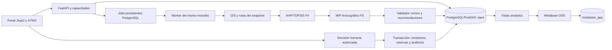

# SIPRE — Revisión técnica de arquitectura

Fecha: 2026-10-16. Dictamen: **viable como diseño académico, condicionado al cierre de decisiones y a pruebas futuras**. No se afirma arquitectura implementada, validada en ejecución ni apta para operaciones reales.

## Auditoría inicial y evidencia

Directorio auditado: `C:\Users\Matias\Downloads\Rally`. Trece archivos originales en la raíz; ningún subdirectorio/código/configuración/prueba existente. `git status --short --branch` devuelve `fatal: not a git repository`; no hay rama, commit, remoto ni diff que auditar. No se ejecutó `git init`. No se encontró `AGENTS.md` en la carpeta ni sus ancestros hasta `C:\`.

Git disponible: 2.55.0.windows.2. `python.exe` es alias WindowsApps; `py --list` informa que no encuentra Python instalado. Docker no aparece en PATH ni en las dos rutas habituales de Docker Desktop comprobadas: no constituye inventario exhaustivo del equipo. No existen manifiestos de dependencias, locks, Compose, Dockerfiles, base de datos ni suite que permitan declarar compatibilidad o pruebas aprobadas.

| Archivo original | Revisión / resultado |
|---|---|
| `SIPRE_PRIORIZACION_v1.md` | Completo: contrato, C1–C8, AHP, TOPSIS, 17 pruebas y pendientes |
| `SIPRE_PRIORIZACION_EJEMPLO.json` | Leído; JSON parseable; cálculo aritmético del ejemplo concuerda con tolerancia |
| `SIPRE_OPTIMIZACION_v1.md` | Completo: MIP mixto, R01–R13, lexicografía, estados, 28 pruebas |
| `SIPRE_OPTIMIZACION_EJEMPLO.json` | Leído; JSON parseable; fixture sintético, no ejecución de solver |
| `SIPRE_ARQUITECTURA_v1.md` | Completo: ADR, datos, API, seguridad, BI, infraestructura, pendientes |
| `SIPRE_CONTRATOS_FASE6_v1.json` | Leído; JSON parseable; contrato descriptivo, no OpenAPI formal |
| `SIPRE_EXPERIMENTOS_v1.md` | Completo: familias, pares, KPI, 26 pruebas; conflicto D03 |
| `SIPRE_ESCENARIOS_CONFIG_v1.json` | Leído; JSON parseable; manifiesto incompleto para generar fixtures definitivos |
| `SIPRE_RESULTADOS_SCHEMA_v1.json` | Leído; JSON parseable; catálogo parcial, no JSON Schema ejecutable |
| `SIPRE_PLAN_EJEMPLO_FASE7.json` | Leído; JSON parseable; cálculo ilustrativo expresamente no ejecutado |
| `README_ENTREGA_FASE7.md` | Leído: reconoce F2/F3 faltantes y exige planificación inicial |
| `PROMPT_CODEX_SIPRE_FASE7.md` | Leído como documentación histórica; sus hitos A–H se mapean a H11–H14 actuales |
| `SIPRE_FASE7_SHA256.txt` | Se verificaron las seis entradas; todas coinciden |
| `SIPRE_FORMULACION_v1.md` | **Falta**: alcance/formulación originales no verificables |
| `SIPRE_SRS_v1.md` | **Falta**: RF/RNF e identificadores oficiales no verificables |

También faltan la pauta íntegra y el PDF de investigación citado; no se atribuyen a ellos decisiones nuevas. No son sustituidos por textos inventados.

Comprobación aritmética de F4 realizada en memoria con PowerShell, sin crear motor: Z01=0.7787338757962583, Z02=0.5481270256972005, Z03=0.6544732639590104; coinciden con el fixture a 1e-5. Es una comprobación documental puntual, **no** ejecución de P4-T01…17, pytest ni certificación numérica integral. F5/F7 se contrastaron por lectura y sus expresiones algebraicas; ningún solver o simulador fue ejecutado.

## Arquitectura comprendida y propuesta

El diagrama expresa dependencias de preparación y cálculo; no impone que todo cálculo F4 necesite optimización. GIS suministra C5 y elegibilidad coherentes con el mismo snapshot. La decisión humana es distinta de `Recommendation`; aceptación sólo registra decisión y reservas del prototipo. No hay integración de despacho.

Se mantiene monolito modular de F6, API y worker en procesos separados con la misma imagen. Se propone una instancia PostgreSQL local con dos bases (`sipre`, `metabase_app`) y credenciales distintas para ahorrar RAM, opción permitida por F6. Compose tiene `db`, `api`, `worker`, `metabase` y un servicio de migraciones de ejecución puntual. Bases sin puertos públicos; API/Metabase ligados a localhost. Alternativa de dos instancias sólo si el equipo requiere aislamiento adicional.

## Coherencia por dominio

| Cruce revisado | Dictamen | Acción verificable |
|---|---|---|
| Requisitos ↔ arquitectura | Cobertura conceptual del pedido; SRS ausente | Trazabilidad provisional; D01 antes de H2 |
| F4 ↔ datos | Factores, perfiles y rangos previstos; faltan referencias/raw policies | D06–D08; almacenar C1–C8 y contribuciones cuadráticas a distancias, no sólo deltas |
| F5 ↔ restricciones | H lineal con parámetros congelados; MIP requiere enteros y continuas | SCIP mediante OR-Tools; implementar todas R01–R13 y verificador independiente |
| GIS ↔ solver | Rutas deben existir antes de variables elegibles | Adelantar H7 a H6; D18 antes de selección de caminos |
| Optimización ↔ simulación | Mismo modelo y universo de restricciones | Contratos comunes de plan/validador/evaluador; FIFO ignora p al asignar |
| Seguridad ↔ decisión | Separación correcta en F6; falta detalle de capacidades y carreras | D12–D15; pruebas transaccionales y CSRF |
| PostgreSQL ↔ Metabase | Arquitectura viable con vistas curadas y DB de aplicación separada | Rol lector sólo SELECT sobre vistas; pruebas reales de permisos, no sólo ocultar tablas en UI |
| Métricas ↔ protocolo | 48 pares previstos y métricas complementarias coherentes | Completar catálogo D10/11, resolver presupuesto D03/04, NA explícito |

## Contratos de persistencia y concurrencia a implementar

Los snapshots deben leer un estado consistente bajo transacción con aislamiento adecuado (propuesta: REPEATABLE READ para captura), guardar revisiones globales de inventario/red, perfiles, observaciones, `as_of_time` y bytes canónicos/hash. El worker usa exclusivamente el snapshot, no mezcla consultas vivas. Resultados y perfiles usados son inmutables; una corrección crea nueva versión.

Para aprobar: identidad de sesión, capacidad y emergencia autorizadas; idempotency key vinculada al actor/operación/hash del cuerpo; lock de recomendación y filas de revisiones/stock/activos en orden estable; revisión de expiración, red, demanda, cantidades, disponibilidad y saldo libre; insertar decisión, reservas y evento de auditoría; commit único. Los cambios viales e inventario deben tomar los mismos locks relevantes: comparar versiones sin sincronizar escritores no elimina la carrera. Dos emergencias comparten identidad física y reservas globales. Segundo intento con misma clave/cuerpo retorna el resultado previo; misma clave con distinto cuerpo es conflicto.

Saldo físico y reservas se distinguen: sugerir no altera ninguno; aceptar reserva; salida/entrega/liberación requieren eventos explícitos y política aprobada D13. No descontar dos veces con ledger y reservas. Se requiere reconstrucción y conciliación por recurso/unidad; no sumar unidades incompatibles.

## Jobs, fallos y semántica

API retorna 202 con ID y URL consultable cuando un job fue persistido. Propuesta SQL: claim atómico de fila, `lease_until`, heartbeat, `attempt`, token de propietario y claves únicas por ejecución; cálculo fuera de transacción larga. Publicar resultados sólo si el token sigue vigente y en una transacción. Tras caída, reintento desde snapshot, preservando intentos; no asumir exactamente una vez. Estados externos F6 se conservan; metadatos técnicos no crean un estado de negocio nuevo sin revisión.

Separar estado job, etapa 1, etapa 2, validez del plan, recomendación y decisión. Timeout sin plan no es infactibilidad; cero stock puede producir plan vacío válido. Fallo etapa 2 sólo conserva etapa 1 si pasa validación de rutas y restricciones, con etiqueta `LOGISTICS_NOT_OPTIMIZED`. Una solución factible sin prueba conserva gap y no se publica como óptima.

## Seguridad y operación propuestas

Sesión de servidor PostgreSQL con cookie opaca, HttpOnly/SameSite, expiración/revocación, CSRF en mutaciones, hash Argon2id y CORS cerrado. Secure obligatorio si se habilita HTTPS; modo HTTP sólo local documentado y sin exponer demo en red. No introducir JWT paralelo para el portal. Roles por capacidades y ámbito de emergencia, no jerarquía. Autenticación Metabase independiente. Perfil de sesión, TTL, lockout/rate limit y autorización de estimaciones requieren aprobación H4.

Roles SQL separados: propietario/migrador, aplicación, worker, propietario limitado de vistas y lector BI. La aplicación no puede modificar/eliminar eventos auditados o resultados congelados por rutas comunes. Auditoría no implica resistencia a administrador de BD. No guardar datos clínicos individuales, RUT, secretos ni cookies en logs/vistas. Probar backups y restauración de ambas bases.

Desconexión de fuentes externas mantiene datos locales y bandera de antigüedad; ausencia de DB impide nuevas decisiones. UI no promete modo offline distribuido. HTMX/CSS locales facilitan demo sin CDN. Metabase puede requerir red para fondo cartográfico; tablas/coordenadas y resto de demo deben seguir funcionando, con limitación visible.

## Resultado de revisión

La viabilidad es una conclusión de diseño respaldada por F4–F7 y fuentes de dependencias, no una aprobación del equipo. Los bloqueos y propuestas completas están en [risks-and-decisions.md](risks-and-decisions.md). H1 puede habilitarse con aprobación explícita limitada; la falta de SRS, perfiles y generador impide declarar proyecto listo para implementación integral sin condiciones.
